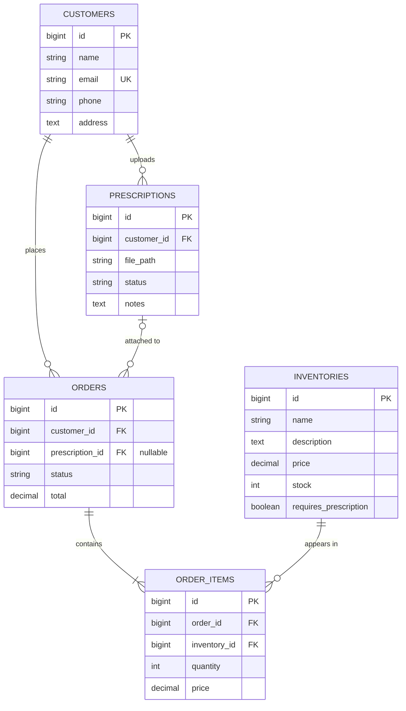

# MediPlus Pharmacy Mobile API

A versioned REST API built with Laravel for the MediPlus Pharmacy mobile app. Customers can browse medicines, place orders, and upload prescriptions.

## API Versioning

All endpoints are prefixed with `/api/v1`.

- **Why version the API?** Once the mobile app is released, users' phones depend on the API's exact shape. If we need breaking changes later, we create `/api/v2` and keep `/api/v1` running, so older app versions don't break.
- **In the URL:** routes are grouped in `routes/api.php` with `Route::prefix('v1')`.
- **In route names:** routes are named `v1.customers.index`, `v1.orders.store`, etc., so future v2 routes won't clash.
- **In the code:** controllers live in `app/Http/Controllers/Api/V1`. A future version gets its own `Api/V2` folder, leaving v1 untouched.

### Endpoints

Each resource uses `Route::apiResource`, which provides 5 routes:

| Method | URL | Action |
|---|---|---|
| GET | /api/v1/{resource} | List all |
| POST | /api/v1/{resource} | Create |
| GET | /api/v1/{resource}/{id} | Show one |
| PUT/PATCH | /api/v1/{resource}/{id} | Update |
| DELETE | /api/v1/{resource}/{id} | Delete |

Resources: `customers`, `prescriptions`, `inventories`, `orders`

## Data Model



### Relationships

| Model | Relationship |
|---|---|
| Customer | hasMany Prescriptions, hasMany Orders |
| Prescription | belongsTo Customer, hasMany Orders |
| Order | belongsTo Customer, belongsTo Prescription (optional), hasMany OrderItems |
| OrderItem | belongsTo Order, belongsTo Inventory |
| Inventory | hasMany OrderItems |

### Design decisions

- **order_items table:** an order can contain many medicines, and a medicine appears in many orders. Each item stores its own `price` so past orders keep the price the customer actually paid, even if the medicine's price changes later.
- **Prices use `decimal(10,2)`**, not float, to avoid rounding errors with money.
- **Deleting a customer** deletes their prescriptions and orders (`cascadeOnDelete`).
- **Deleting a prescription** keeps the order and sets `prescription_id` to null (`nullOnDelete`).
- **A medicine that appears in past orders cannot be deleted**, which protects order history.
- **`requires_prescription`** flags medicines that need a prescription before they can be ordered.

## Setup

```bash
git clone <repo-url>
cd medipluspharmacy
composer install
cp .env.example .env
php artisan key:generate
php artisan migrate
php artisan serve
```